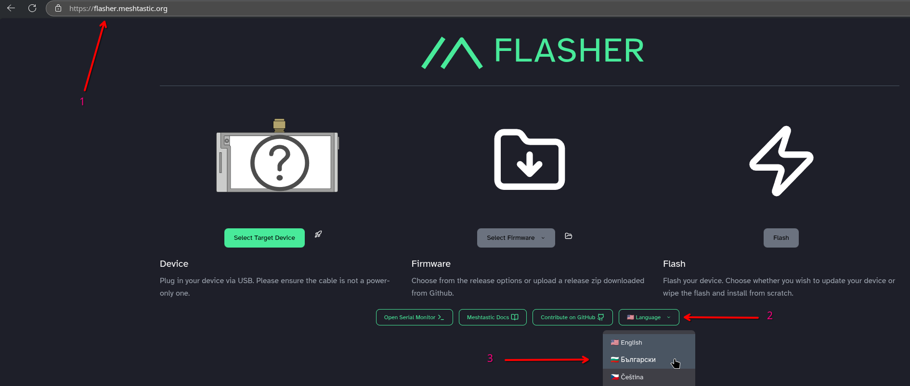
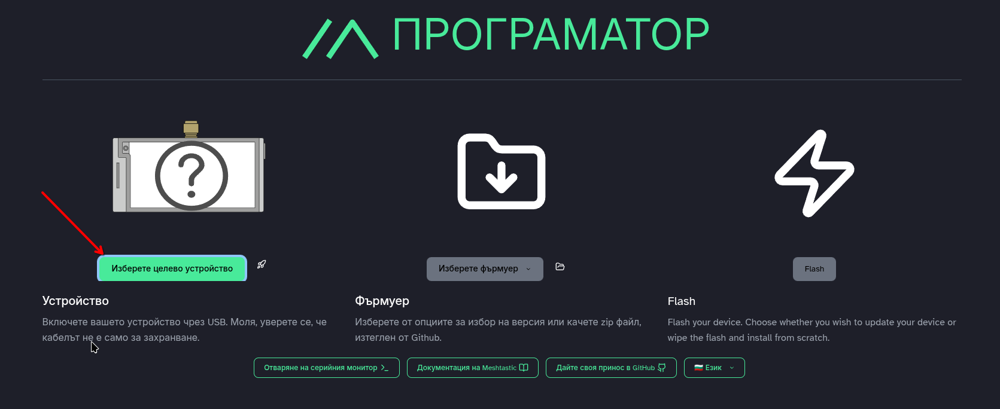
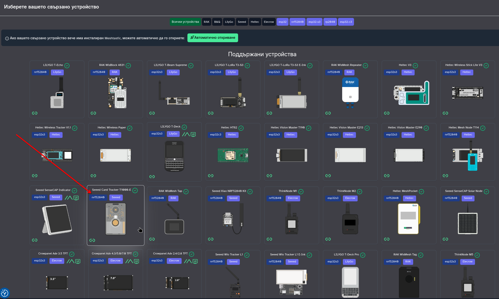
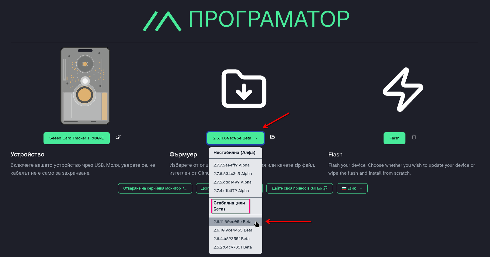
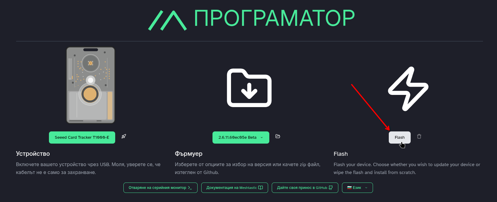
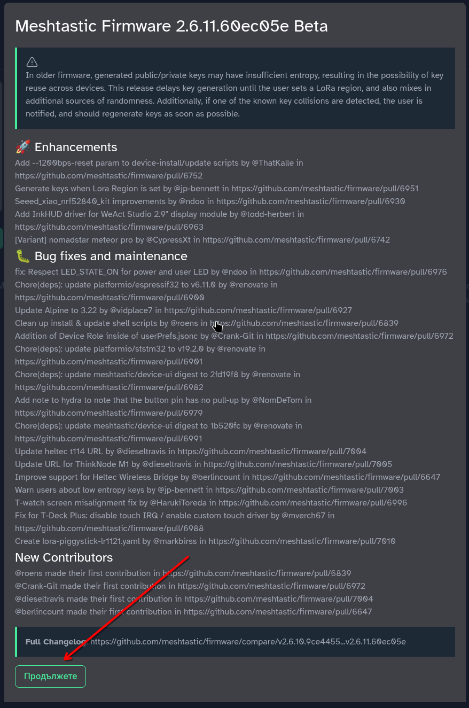
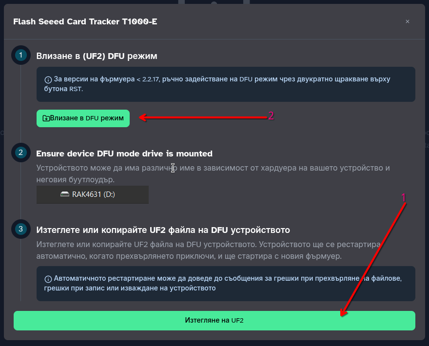
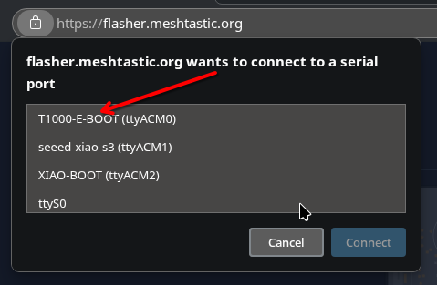
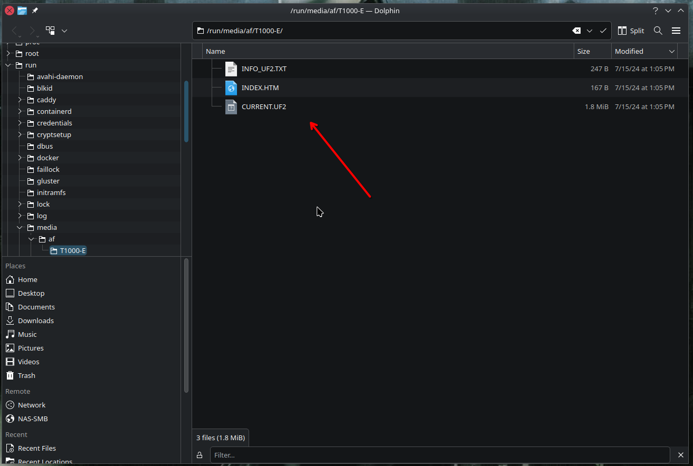

# 2.01. Фърмуер за T1000-E

## Стъпки за флашване на последния фърмуер от Мештастик

1. Свържете нода с магнитния кабел към компютъра.
    - Първо свържете кабела към компютъра, а после магнитния край към тракера.
    - Трябва да чуете звук от нода и да мига зеленият светодиод.

2. Отворете Google Chrome или Microsoft Edge (не работи с Firefox)
    - Отворете адреса [https://flasher.meshtastic.org](https://flasher.meshtastic.org).
    - От менюто за език изберете `Български`.

    

3. Натиснете бутона за избор на нод.

    

4. Изберете правилния нод, в този случай `T1000-E`.

    

5. Ако желаете, изберете различен фърмуер от последния стабилен. За предпочитане е да оставите вече избрания от системата фърмуер и да прескочите тази стъпка. Системата е избрала последната версия на стабилен фърмуер за вас.

    

6. Натиснете бутона за програмиране.

    

7. След показване на информация за фърмуера, приемете и продължете напред.

    

8. На следващия екран първо изтеглете UF2 файла – това е фърмуерът. След това влезте в DFU режим.

    

9. За да вкарате нода в DFU режим, трябва да изберете правилния сериен порт. Ако имате няколко устройства, свързани към компютъра, ще виждате всички. Изберете правилния нод.

    

10. Ако всичко е успешно, трябва да видите ново USB устройство за запис, подобно на външен диск или флашка. Ако го виждате, преминете към следващата стъпка. Ако не, прочетете тази точка до края.

    Ако не се е появило ново дисково устройство, значи процедурата през браузъра за рестарт в DFU режим не е сработила.
    Задръжте бутона на тракера и леко откачете магнитния кабел, без да го махате напълно. Направете това два пъти бързо, докато държите бутона натиснат.

    **ВАЖНО:** Ако нещо се обърка и не можете да върнете нода към живот: 1. изключете кабела, 2. задръжте бутона, 3. включете кабела.

11. Поради ограничени тестове на различни операционни системи, примерният screenshot по-долу е от Linux. Стъпката е аналогична в Windows и macOS: трябва да видите ново външно устройство (тип USB storage).

    

12. Копирайте изтегления UF2 файл в тази папка. След това нодът ще се рестартира сам.

13. С това трябва да приключи обновяването на фърмуера.
