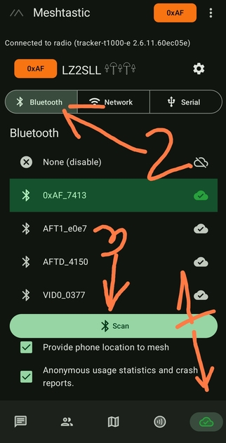
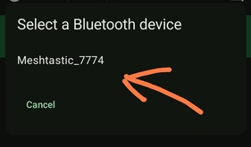
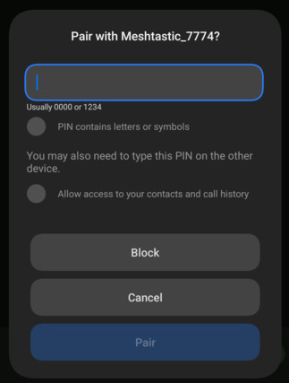
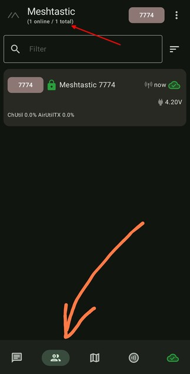

# 3.01. Връзка към устройството

> **Преди да започнете**
> Нодът е зареден и включен.
> На телефона има инсталирано приложението Meshtastic.
> Ако имате екран на нода, проверете PIN кода на дисплея.

Тези стъпки са за Android. За iOS логиката е същата. Може да ползвате и [уеб клиента](https://client.meshtastic.org) на Meshtastic, но той не работи коректно във Firefox.

## Стъпки

1. Включете нода с еднократно натискане на бутона.

2. Инсталирайте приложението [Meshtastic за Android](https://play.google.com/store/apps/details?id=com.geeksville.mesh).

3. Стартирайте приложението и сканирайте за Bluetooth устройства.

    

4. Изберете вашия нод от списъка с намерени устройства.

    

5. Въведете PIN кода. По подразбиране е `123456`, освен ако нодът не показва друг PIN на екрана.

    

6. Изчакайте няколко секунди до успешна връзка.

    

## Проверка

Връзката е успешна, когато виждате нода в приложението и няма грешка за Bluetooth.

## Ако не се получи

- Проверете дали Bluetooth е включен.
- Проверете дали PIN кодът е въведен правилно.
- Изключете и включете нода, после опитайте пак.

## Следваща стъпка

Продължете към [3.02. Смяна на името](3.02.%20Смяна%20на%20името.md).
