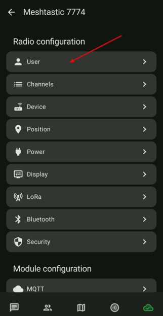
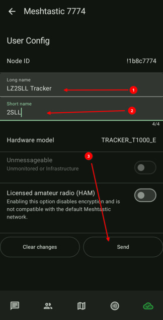

# 3.02. Смяна на името

> **Преди да започнете**
> Нодът е свързан успешно (виж [3.01. Връзка към устройството](3.01.%20Връзка%20към%20устройството.md)).

## Защо е важно

Добро име помага на другите да ви разпознават в мрежата. Краткото име е до 4 символа, а дългото име е до 40 символа.

## Стъпки

1. Влезте в настройките и отворете секция `USER`.

    

2. Попълнете:
   - `Short name` с кратка, лесна за разпознаване стойност
   - `Long name` с пълно име/позивна

    

## Проверка

След запис името на нода се вижда обновено в списъка с нодове.

## Следваща стъпка

Продължете към [3.03. Радио настройки](3.03.%20Радио%20настройки.md).
