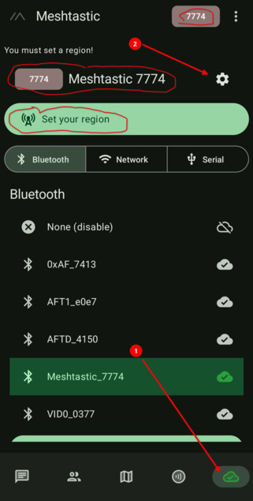
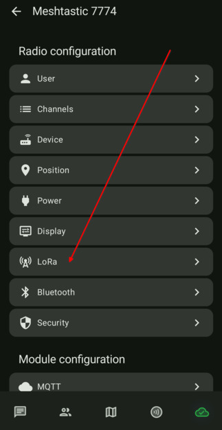
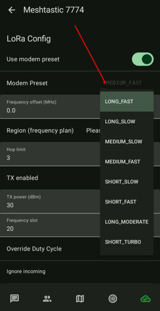
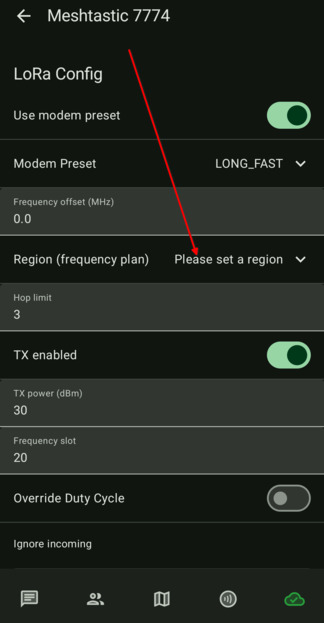
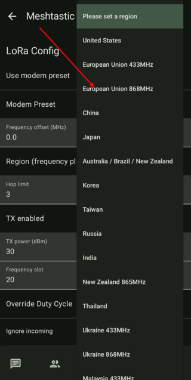
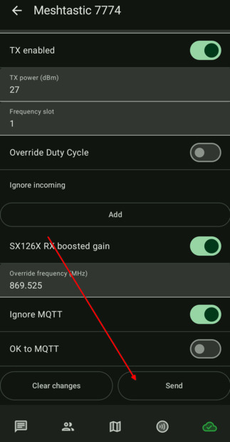
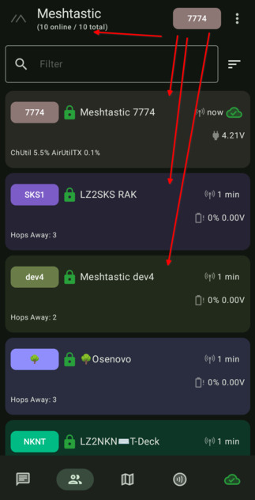

# 3.03. Радио настройки

> **Преди да започнете**
> Завършени са [3.01. Връзка към устройството](3.01.%20Връзка%20към%20устройството.md) и [3.02. Смяна на името](3.02.%20Смяна%20на%20името.md).
> Нодът е свързан и се вижда в приложението.

## Защо е важно

Варненската мрежа работи с `MEDIUM_FAST` и регион `EU_868`. Ако тези настройки са различни, няма да комуникирате нормално с останалите нодове.

## Стъпки

1. Отворете таба за връзки и натиснете бутона за настройки.

    

2. Влезте в LoRa настройките.

    

3. Задайте модем пресет `MEDIUM_FAST`.

    

4. Изберете регион.

    

5. Задайте `European Union 868Mhz (EU_868)`.

    

6. Запазете настройките (Save). Устройството ще се рестартира и ще се свърже отново.

    

7. Изчакайте повторното свързване и проверете списъка с нодове.

    

## Проверка

Настройката е успешна, когато пресетът е `MEDIUM_FAST`, регионът е `EU_868`, и виждате други нодове в списъка.

## Ако не се получи

- Изберете временно `NONE` за свързано устройство и върнете обратно вашия нод.
- Уверете се, че сте натиснали Save.
- Изчакайте няколко минути, ако сте в зона с по-малко активни нодове.

## Следваща стъпка

Продължете към [3.04. Настройка на ролята](3.04.%20Настройка%20на%20ролята.md).
