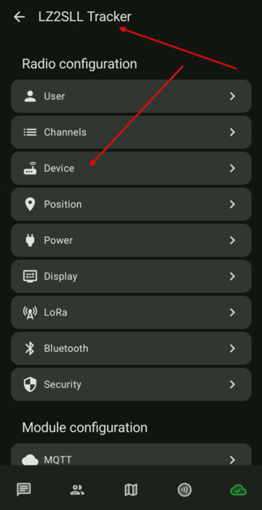
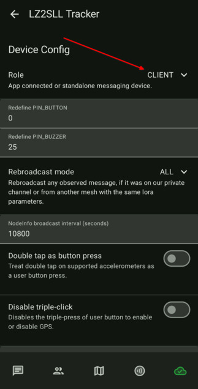
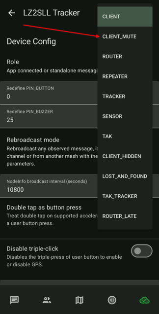
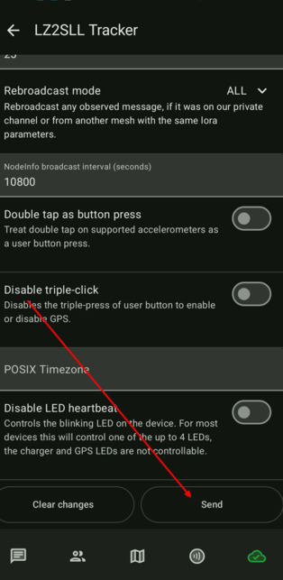

# 3.04. Настройка на ролята

> **Преди да започнете**
> Завършена е [3.03. Радио настройки](3.03.%20Радио%20настройки.md).

## Защо е важно

Ролята на нода контролира как той препредава пакети и колко натоварва мрежата. За повечето преносими нодове в градска среда най-подходящо е `CLIENT_MUTE` или `CLIENT`.

Подробно описание на ролите има и в официалния материал: [Choosing the right device role](https://meshtastic.org/blog/choosing-the-right-device-role/).

| Роля | Препращане на съобщения | Видим в списъка с нодове | Консумация на енергия | BLE/WiFi/Serial | Препоръчва се за |
| --- | --- | --- | --- | --- | --- |
| CLIENT | Да, при необходимост | Да | Нормална | Да | Обща употреба, най-вече за стационарни нодове |
| **CLIENT_MUTE** | Не | Да | Ниска | Да | В градски условия или мрежа с много устройства. **Ако ползвате MQTT брокер, задължително сложете тази роля.** |
| CLIENT_HIDDEN | Само локални | **Не** | Ниска | Да | Невидим нод с пестене на енергия |
| TRACKER | Само ако е буден | Да | Нормална или ниска | Да | Следене и локация |
| LOST_AND_FOUND | Да | Да | Нормална | Да | Издирване на устройство |
| SENSOR | Само ако е буден | Да | Нормална или ниска | Да | Наблюдение на околната среда |
| ROUTER | Да | Да | Висока | Да | Инфраструктурен нод за разширяване на мрежата |
| ROUTER_LATE | Да | Да | Висока | Да | Покриване на мъртви точки |
| REPEATER | Да | **Не** | Висока | Да | Невидим рутер |

## Стъпки

1. Отворете настройките и изберете `Device`.

    

2. Отворете списъка с роли.

    

3. За тракер/преносим нод задайте `CLIENT_MUTE`.

    

4. Запазете настройките.

    

## Проверка

Ролята е зададена правилно, когато след отваряне на `Device` виждате `CLIENT_MUTE` като активна стойност.

## Следваща стъпка

Продължете към [3.05. Запазване на ключовете](3.05.%20Запазване%20на%20ключовете.md).
