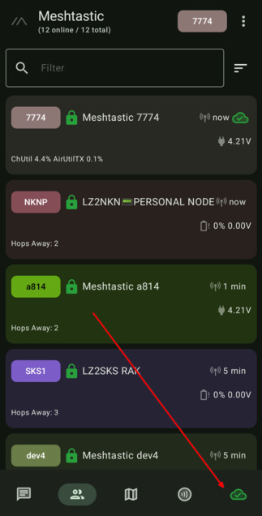
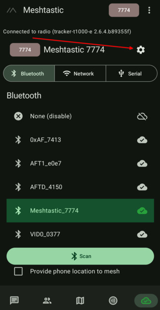
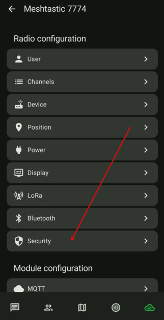
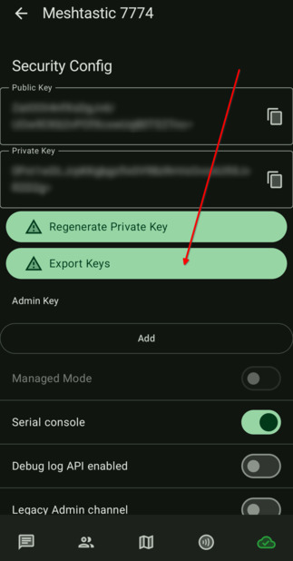

# 3.05. Запазване на ключовете

> **Преди да започнете**
> Избрали сте роля на нода в [3.04. Настройка на ролята](3.04.%20Настройка%20на%20ролята.md).
> Имате стабилна връзка към нода.

## Защо е важно

Запазването на личния и публичния ключ е критично. Ако регенерирате ключовете без нужда, останалите нодове ще ви виждат като познат нод, но с нови ключове и комуникацията ще се наруши, докато всеки не ви изтрие от NodeDB-то си. Няма да имате възможност да приемате или изпращате директни съобщения. Единствено съобщенията в каналите ще са видими.

## Стъпки

1. Отворете настройките от долната дясна иконка.

    

2. Натиснете зъбното колело за детайлни настройки.

    

3. Влезте в секция `Security`.

    

4. Запишете и архивирайте ключовете на сигурно място.

    

## Проверка

Имате локално копие на ключовете и знаете къде е записано.

## Ако не се получи

- Ако не намирате `Security`, върнете се една стъпка назад и отворете пак зъбното колело.
- Ако сте натиснали опция за регенериране по грешка, прегледайте [6.01. Често срещани проблеми](../5.%20Отговори/6.01.%20Често%20срещани%20проблеми.md).

## Следваща стъпка

Продължете към [4.01. Локация и GPS](4.01.%20Локация%20и%20GPS.md).
