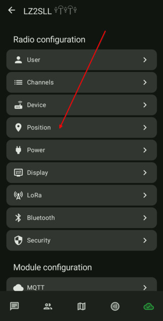
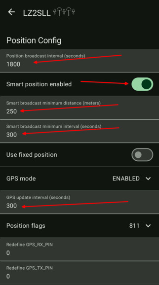

# 4.01. Локация и GPS

> **Преди да започнете**
> Основната настройка е готова до [3.05. Запазване на ключовете](3.05.%20Запазване%20на%20ключовете.md).

## Защо е важно

GPS настройките влияят на батерията и натоварването на ефира. При преносими нодове е добре да намалите честотата на репортите.

## Стъпки

1. Отворете настройките на нода и изберете секция `Position`.

    

2. Настройте параметрите според желания баланс между точност и батерия.

    

## Проверка

След запис нодът публикува локация с очакваната честота и без излишен разход на батерия.

## Следваща стъпка

Продължете към [4.02. MQTT брокер](4.02.%20MQTT%20брокер.md).
