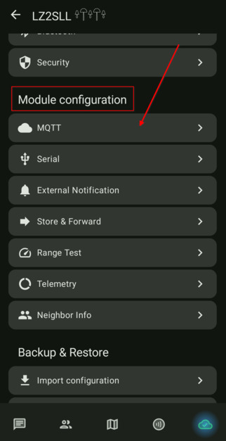
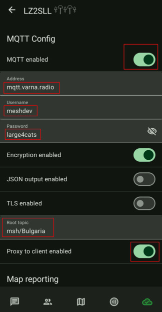
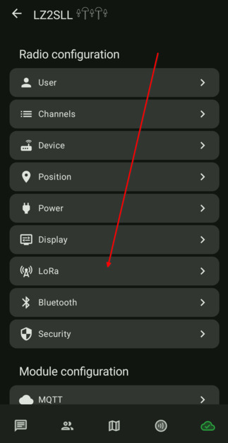
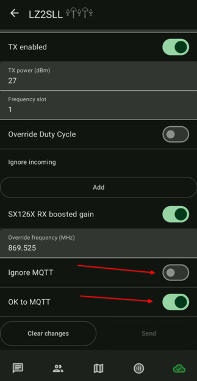
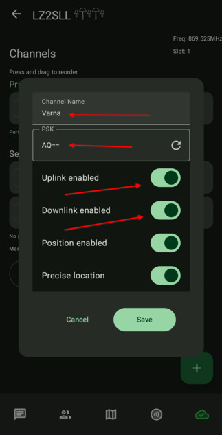
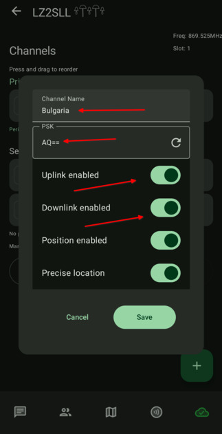

# 4.02. MQTT брокер

> **Преди да започнете**
> Завършени са всички стъпки от първоначалната настройка.
> Нодът е на роля `CLIENT_MUTE` (виж [3.04. Настройка на ролята](3.04.%20Настройка%20на%20ролята.md)).

## Защо е важно

MQTT брокерът позволява комуникация през интернет, когато нодовете не са в пряк радиоефирен обхват. Това е полезно, но не трябва да претоварва локалния ефир.

## ВАЖНО

Ако ползвате MQTT и канал `Bulgaria`, ролята трябва да е `CLIENT_MUTE`. Иначе нодът може да препредава интернет трафик към локалния ефир.

## Стъпки

1. Отворете настройките на нода и изберете `Module Configuration -> MQTT`.

    

2. Попълнете основните MQTT настройки:
   - MQTT Enabled: `ON`
   - Address: `mqtt.varna.radio`
   - Username: `meshdev`
   - Password: `large4cats`
   - Topic: `msh/Bulgaria`
   - Proxy to client: `ON`

    

3. След запис и рестарт отворете LoRa настройките за допълнителните MQTT флагове.

    

4. Задайте:
   - Ignore MQTT: `OFF`
   - OK to MQTT: `ON`

    

5. В каналите разрешете пренос през брокера.

    
    
    

## Проверка

MQTT е активен, когато:

- нодът е свързан към `mqtt.varna.radio`
- каналите са с правилните MQTT опции
- ролята е `CLIENT_MUTE`

## Ако не се получи

- Проверете отново username/password/topic.
- Проверете интернет свързаността на нода.
- Прегледайте [6.01. Често срещани проблеми](../5.%20Отговори/6.01.%20Често%20срещани%20проблеми.md).

## Следваща стъпка

Продължете към [4.03. Нотификации - звук и светлина](4.03.%20Нотификации%20-%20звук%20и%20светлина.md).
  