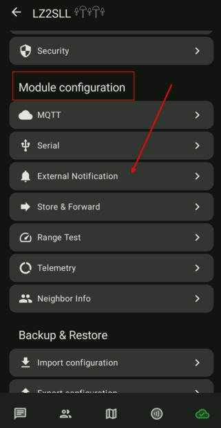
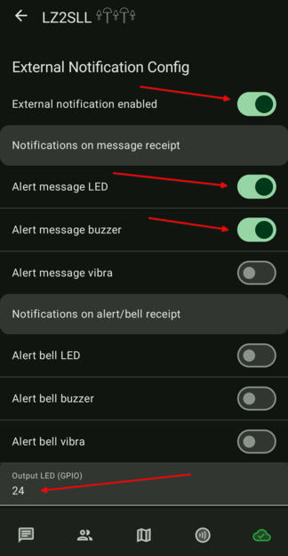
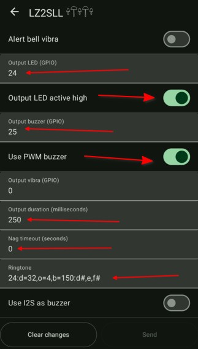

# 4.03. Нотификации - звук и светлина

## Тези настройки са за T1000-E тракерите

> **Преди да започнете**
> Ако ползвате MQTT, уверете се че е настроен правилно в [4.02. MQTT брокер](4.02.%20MQTT%20брокер.md).

T1000-E има buzzer и LED. По подразбиране алармата може да е дълга и досадна. Тук настройваме кратки и по-практични нотификации.

## Стъпки

1. Отворете `Module Configuration -> External Notification`.

    

2. Променете настройките:
   - External Notification Enabled: `ON`
   - Alert message LED: `ON`
   - Alert message buzzer: `ON`
   - Output LED (GPIO): `24`
   - Output LED active high: `ON`
   - Output buzzer (GPIO): `25`
   - Use PWM buzzer: `ON`
   - Output duration: `250`
   - Nag timeout: `0`
   - Ringtone: `24:d=32,0=4,b=150:d#,e,f#`

    
    

## Проверка

При ново съобщение има кратка светлинна/звукова индикация без дълго повтаряне.

## Следваща стъпка

Продължете към [4.04. Телеметрия](4.04.%20Телеметрия.md).
