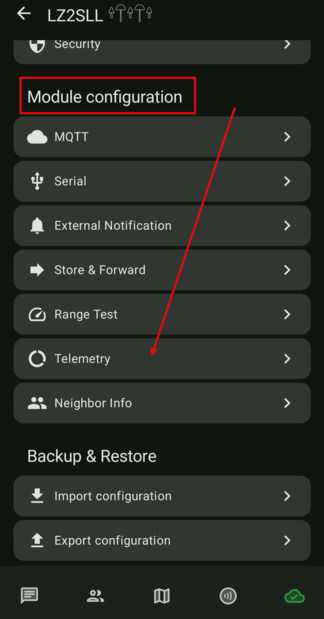
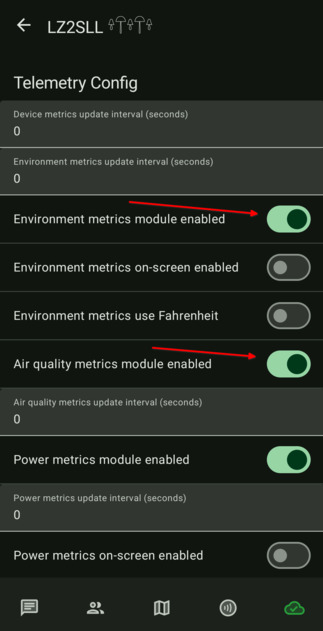
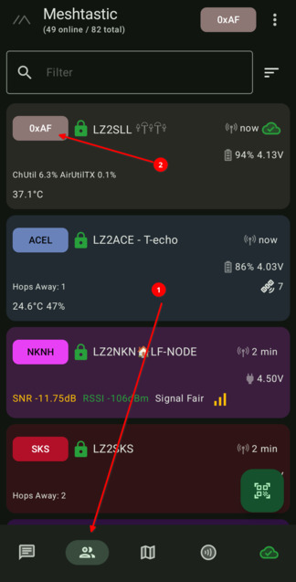
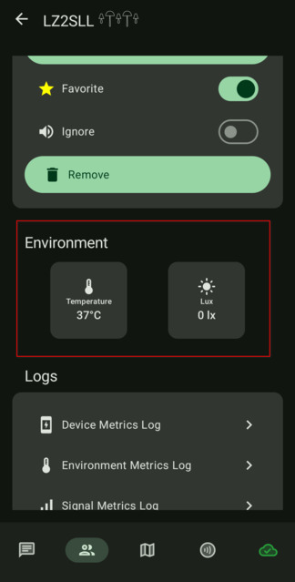

# 4.04. Телеметрия

## Тези настройки са за T1000-E тракерите

T1000-E има вградени сензори (температура и осветеност), които може да се репортват в мрежата.

## Стъпки

1. Отворете `Module Configuration -> Telemetry`.

    

2. Активирайте нужните telemetry модули:
   - Environment metrics module enabled: `ON`
   - Air quality metrics module enabled: `ON`

    

3. След рестарт проверете дали виждате актуални telemetry данни.

    
    

## Проверка

Ако модулите са активни, данните за сензорите се обновяват периодично.

## Следваща стъпка

Продължете към [4.05. Канали](4.05.%20Канали.md).
