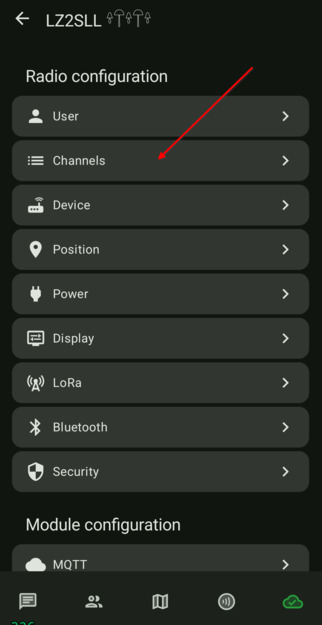
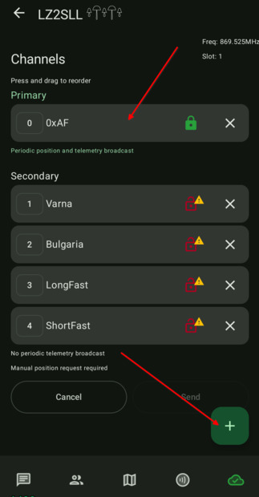
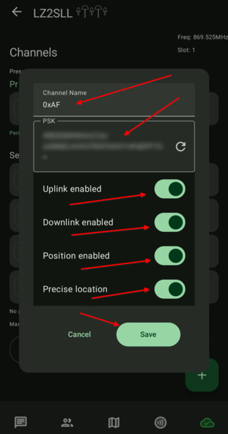
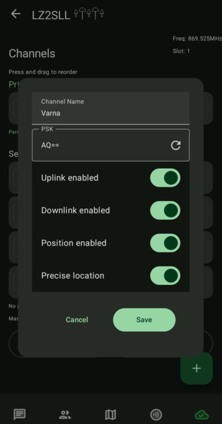
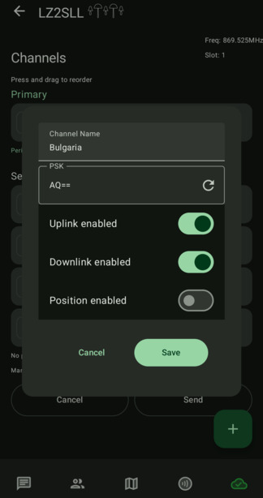
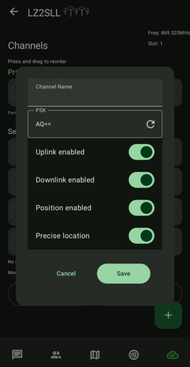

# 4.05. Канали

> **Преди да започнете**
> Завършени са [3.03. Радио настройки](3.03.%20Радио%20настройки.md) и [4.02. MQTT брокер](4.02.%20MQTT%20брокер.md), ако ще ползвате MQTT.

## Важно

Телеметрията се публикува в primary канала. Добра практика е primary каналът да е ваш личен канал с ваш собствен ключ.

## Стъпки

1. Отворете секция `Channels`.

    

2. Редактирайте primary канала, после добавете secondary канали.

    

3. За primary канала изберете име и ключ, които са еднакви на всички ваши устройства.

    

4. За secondary канали добавете `Varna` и `Bulgaria` с ключ `AQ==`.

5. Ако ви трябва временна съвместимост, може да добавите и `LongFast`/`ShortFast` като допълнителни secondary канали.

6. Ако канал `Bulgaria` се пренася през MQTT, ролята трябва да е `CLIENT_MUTE`.

    
    
    

## Проверка

Каналите са коректни, когато:

- primary каналът работи между вашите устройства
- `Varna`/`Bulgaria` са добавени с ключ `AQ==`
- при MQTT сценарий ролята е `CLIENT_MUTE`

## Ако не се получи

- Проверете дали ключът на канала е правилен.
- Проверете дали всички устройства са на един и същ пресет.
- Вижте [6.01. Често срещани проблеми](../5.%20Отговори/6.01.%20Често%20срещани%20проблеми.md).

## Следваща стъпка

Продължете към [5.01. MediumFast](../4.%20Промяна%20на%20пресет/5.01.%20MediumFast.md) за справка защо този пресет е стандарт за мрежата.
